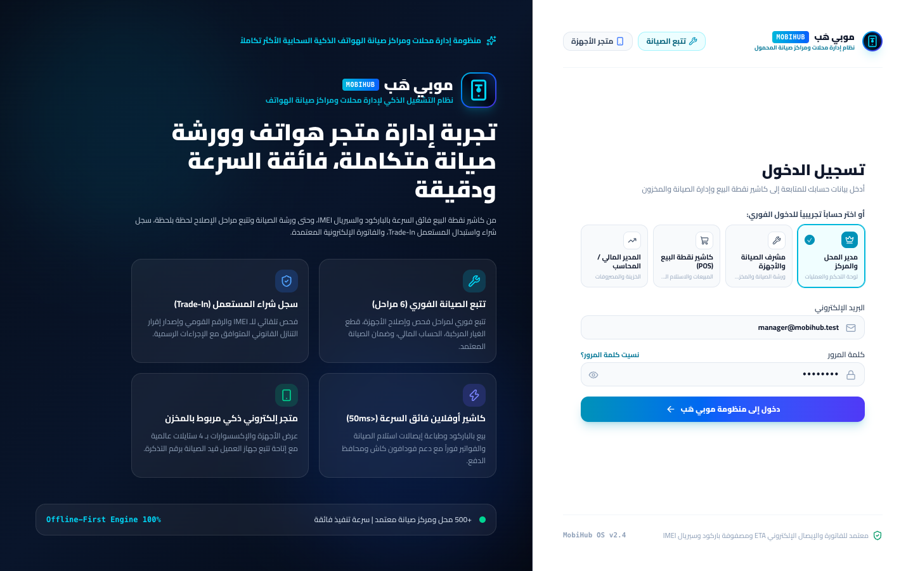
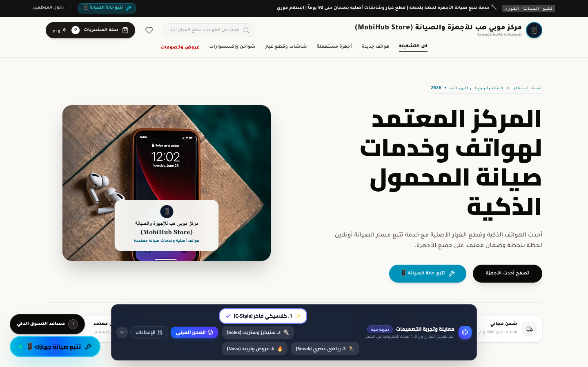
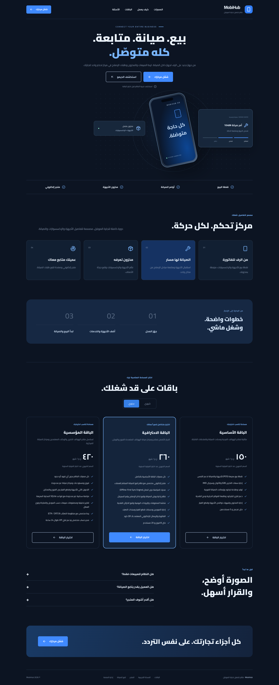

# MobiHub (موبي هَب)

> Cloud platform for mobile phone shops and repair centers.

**Live:** [mobihub.virvib.com](https://mobihub.virvib.com/) · **Role:** Founder & developer · **Period:** 2026 · **For:** Own product

    

## Overview

Phone shops sell and repair devices; customers follow their repair online.

## What it does

- Repair tickets and maintenance tracking
- POS and storefront
- Public repair tracking for customers
- Flutter mobile app

## Engineering highlights

- Shared Laravel API for web and Flutter
- Automated deploys

## Screenshots (live site)

  
  
  

Full home page

---

Source code is private (client / commercial project). This repository documents the work only.

Built by **Ahmed Gamal** — Senior Laravel Developer · [LinkedIn](https://www.linkedin.com/in/wzcoder/) · [GitHub](https://github.com/ahmed-gamal-dev)
